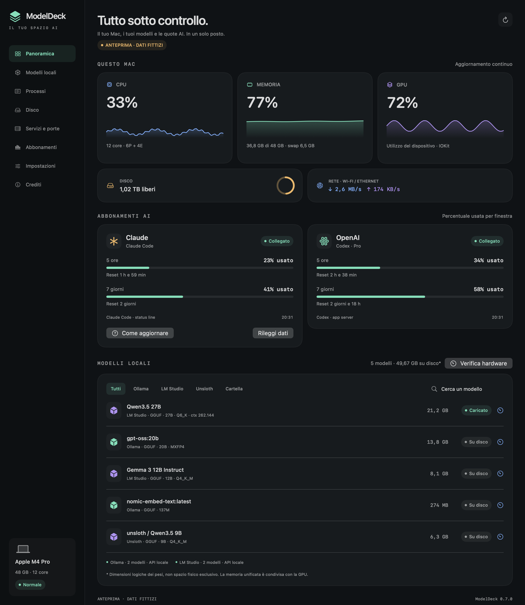

# ModelDeck

A native macOS dashboard for your Mac, local LLMs, and Claude Code / Codex subscription quotas.

Built with SwiftUI and Swift Charts. macOS 14 or later. No package dependencies, telemetry, browser cookies, or model inference requests.



The screenshot uses **synthetic demonstration data**, not a real account or a performance benchmark. The initial interface is in Italian.

## Features

- Live CPU, memory, swap, disk capacity, network throughput, battery and thermal state.
- Optional GPU utilization when exposed by the Mac's IORegistry. Unavailable metrics display `—`.
- Light, dark and system appearance, shared by the dashboard and menu bar panel.
- Local model inventory from Ollama, LM Studio and Unsloth, plus custom GGUF / Safetensors folders.
- Loaded-model state and Ollama GPU allocation when reported by the local server.
- Codex quota windows, percentages used, reset times and plan when provided.
- Claude Code quota windows via its documented status line data.
- Process detail with CPU, resident memory, PID, path, thread count and detected GPU clients.
- Confirmed termination (SIGTERM) or forced termination (SIGKILL) for your own processes, with PID identity validation.
- Native menu bar icon: left click for the panel, right click for actions, and dashboard reopening after closing its window.
- Selectable menu bar values beside the icon: CPU, RAM, GPU and Claude/OpenAI quota windows, with used or remaining percentages.
- Compact, two-row and detailed menu bar layouts, with vector-rendered text that adapts to menu bar contrast.
- Hardware fit estimator with public Hugging Face metadata, local GGUF/config metadata, configurable context, KV cache precision and memory margins.
- Public Hugging Face model search by partial name, with selectable results and GGUF/MLX filters.
- Credits page linking the author, source repository, issue tracker and license.
- Full dashboard, Finder shortcuts and launch at login.

[Light appearance](docs/dashboard-light.png) · [Process detail](docs/processes.png) · [Hardware fit estimator](docs/model-fit.png) · [Credits](docs/credits.png). All previews use synthetic data.

[Disk explorer](docs/disk.png) · [Services & ports](docs/services-english.png) · [English settings](docs/settings-english.png) · [Claude refresh guide](docs/claude-refresh.png).

The project name and icon are provisional while the feature set is being developed.

## Interface language

Open **Settings → Language** (**Impostazioni → Lingua**) to choose **Automatic**, **Italiano** or **English**. The preference is saved and applied immediately to the interface, native menus and help. Automatic follows the preferred macOS language, using English when Italian is not selected. File names, model names and paths are retained. Regional number formats can continue to follow macOS settings.

## Menu bar values

Open **Impostazioni → Barra dei menu** to select any combination of CPU, RAM, GPU, Claude Code and OpenAI/Codex. CPU and RAM are enabled by default. Disable every value to keep only the icon. Preferences are saved and applied without restarting; the icon retains its left/right-click actions. **Disposizione** offers compact, two-row and detailed layouts. Two rows is the new default, including when migrating existing preferences; selected metrics, quota meaning and window choices are preserved.

RAM can show percentage or used memory. Each provider has its own quota-window selector, including any additional Codex buckets reported by the service. Choose used or remaining percentages for both providers. Compact mode shows `Claude 0% · OpenAI 99%`; two-row mode stacks pairs of readings with aligned names and percentages. The vector-backed template image uses 9–9.5 pt text with semibold values, rendered at the display's scale. Detailed mode includes window and meaning directly, for example `Claude 7g 0% rimanente`. All modes retain full window, meaning, reset and freshness information in the tooltip and accessibility label. [Layout comparison with synthetic data](docs/menu-bar-layouts.png).

Unavailable/expired values display `—`, never a guessed zero. An asterisk marks last-known quotas older than ten minutes or a failed refresh. An explicitly selected window that disappears stays unavailable rather than switching silently to another quota. Automatic selection uses the **most restrictive active reported quota**, comparing Claude's returned limits and Codex's main bucket windows. Separate Codex buckets such as review limits remain selectable explicitly. An exhausted weekly limit therefore shows 0% remaining even if the five-hour window is unused. If a main window has expired, the effective quota stays unavailable until refreshed, unless another valid window already proves that usage is blocked. The values share the dashboard's refresh intervals and do not trigger additional service requests. Clicking the icon opens/closes the panel; it does not hide the selected bar values.

[Menu bar settings preview](docs/settings-light.png), using synthetic demonstration data.

## Build and run

Install Xcode (or the Command Line Tools) with a Swift 5.10+ toolchain, then:

```sh
git clone https://github.com/tommasinigiovanni/ModelDeck.git
cd ModelDeck
bash scripts/build.sh
open build/ModelDeck.app
```

To keep the app installed, copy `build/ModelDeck.app` to `~/Applications` **before connecting Claude Code**. The status line references the executable in its installed location. Moving the app later requires restoring and reconnecting the bridge.

```sh
mkdir -p ~/Applications
ditto build/ModelDeck.app ~/Applications/ModelDeck.app
open ~/Applications/ModelDeck.app
```

The local build is ad hoc signed. There is no Developer ID signature, notarization, automatic updater or App Store distribution in this initial version. CI produces an app archive for its runner's architecture; it is not a universal binary.

The Command Line Tools can build the application; the XCTest suite requires the full Xcode test frameworks and an accepted Xcode license. To build with installed Command Line Tools without changing the global developer selection, use `env DEVELOPER_DIR=/Library/Developer/CommandLineTools bash scripts/build.sh`.

For development, `swift run ModelDeck` works. A generated `ModelDeck.xcodeproj` is also included. To regenerate it after changing targets, install [XcodeGen](https://github.com/yonaskolb/XcodeGen) and run `xcodegen generate`.

## Connect your tools

### Ollama

Start your existing Ollama server. ModelDeck reads [`GET /api/tags`](https://docs.ollama.com/api/tags) and [`GET /api/ps`](https://docs.ollama.com/api/ps) at `http://127.0.0.1:11434`. If the server is offline, it reads manifests in `~/.ollama/models/manifests`. For a custom `OLLAMA_MODELS` directory, run the server with that directory: the API remains authoritative.

Opening a model's hardware check can also call [`POST /api/show`](https://docs.ollama.com/api-reference/show-model-details) with `verbose: false` to read attention metadata. This does not load the model or request inference.

### LM Studio

Start LM Studio's local server. ModelDeck uses [`GET /api/v1/models`](https://lmstudio.ai/docs/developer/rest/list) at `http://127.0.0.1:1234`, with a v0 fallback on HTTP 404. If authentication is enabled, save the server token in Settings; it is stored in the macOS Keychain.

Offline discovery scans `~/.lmstudio/models` and `~/.cache/lm-studio/models`. Add custom locations in Settings. Safetensors shards in a directory containing `config.json` and numbered GGUF parts are grouped as one model. Incomplete numbered shard sets are excluded. Projector files containing `mmproj` and adapter-only weights are excluded. Loaded state is unknown while the API is unavailable. Embedding models are included.

### OpenAI / Codex

Install [Codex CLI](https://learn.chatgpt.com/codex) and sign in with `codex login`. ModelDeck starts a short-lived `codex app-server` process, initializes JSON-RPC, calls [`account/rateLimits/read`](https://learn.chatgpt.com/docs/app-server), and stops it. It never starts a thread or turn. Codex manages its own authentication; ModelDeck does not copy its credentials.

These are **Codex usage quotas associated with your ChatGPT plan**, not every ChatGPT model's message limit and not OpenAI API billing. Missing data stays unavailable. All returned quota buckets are displayed; values are not inferred from token counts.

### Unsloth

ModelDeck reads the local [Unsloth Studio](https://unsloth.ai/docs/get-started/install/mac) OpenAI-compatible `GET /v1/models` catalog and, when available, `GET /api/inference/loaded-models`. The default endpoint is `http://127.0.0.1:8888`; change it in Settings. An optional API key is saved in the macOS Keychain. ModelDeck does not read Unsloth authentication databases or mint keys.

Offline discovery scans the `models`, `library`, `outputs` and `exports` directories under `~/.unsloth/studio`, plus Hugging Face snapshots under `~/.cache/huggingface/hub`. The shared HF cache is grouped under Unsloth in the inventory; its presence does not mean a model was created or exclusively used by Unsloth. Cache symlinks are followed for weight sizes, and the `refs/main` snapshot is preferred when present.

Three model-directory preferences (`hugging_face_cache_home`, `hugging_face_cache_history`, `hugging_face_download_homes`) are read from Unsloth's `app_settings` table in immutable read-only mode. This uses the database's last checkpoint and does not create sidecars or read chat tables. Active API listings are authoritative when available. Additional cache/export directories and external disks can be added with **Aggiungi cartella Unsloth**. If the local schema changes or a database cannot be read, manual folders remain available.

### Claude / Claude Code

In Settings, choose **Collega Claude Code**, then restart Claude Code and send a message. A compatible Claude subscription and a Claude Code version exposing [`rate_limits` in status line JSON](https://code.claude.com/docs/en/statusline) are required. Quotas arrive after responses and may be absent for some account types or windows.

Click **Needs refresh / Da aggiornare** or **How to refresh / Come aggiornare** on the Claude card for connection status and step-by-step instructions. **Read latest data / Rileggi dati** rereads data already received; it does not query Claude or start a conversation. If the timestamp does not change, wait for a response in a Claude Code terminal session, and check the connection or project-specific status line overrides. Expired windows require refresh even when the capture timestamp is recent.

The bridge updates `~/.claude/settings.json`, preserves other settings, and chains your previous status line command with its original input. It stores the previous status line configuration in `~/Library/Application Support/ModelDeck/claude-bridge.json`. Use **Ripristina status line** before uninstalling ModelDeck. If another tool changes the status line after installation, restoration refuses to overwrite it; the backup remains available.

The same reversible setup is available from the installed app's command line:

```sh
~/Applications/ModelDeck.app/Contents/MacOS/ModelDeck --connect-claude
# To restore the previous status line:
~/Applications/ModelDeck.app/Contents/MacOS/ModelDeck --disconnect-claude
```

Only quota percentages, reset timestamps and capture time are written to `claude-usage.json` in the same application support directory (permissions `0600`). No prompts, transcript paths, tokens, email addresses or account identifiers are stored. The bridge does not make network requests. Claude's quota display updates from active sessions; it is not independent background polling. Project-specific status line overrides may take precedence over the user settings bridge.

## Does a model fit this Mac?

In **Modelli locali**, choose **Verifica hardware** to check any model, or the gauge icon on a model row to prefill its local weight size and attention metadata.

Type a partial model name such as `qwen` or `llama` and choose **Cerca**, optionally filtering for GGUF or MLX. Up to 20 public results are shown by download count, with repository, format and available metadata. Select a result to import its metadata. Search uses fragments of model IDs; it does not guarantee spelling correction. An exact public repository ID or repository URL can be loaded directly with **Importa ID/link**. [Search preview](docs/model-search.png) uses synthetic data.

The app reads the [Hub API](https://huggingface.co/docs/hub/api) file sizes and `config.json`, using the repository revision when available, or the declared base model's config as a fallback. Quantizations appear as alternatives; complete GGUF shard sets are summed. No weights, tokens or inference are requested, and no Mac hardware details are sent to Hugging Face. Public search terms and selected repository IDs are sent to Hugging Face only on search/import actions. Editing a query cancels an in-flight search and discards old results. Restricted/private repositories require manual data. Requests have time and response-size limits.

The estimate is **weights + KV cache + runtime margin**. KV memory uses layer count, KV heads (including GQA), key/value dimensions, context length, simultaneous sequences and cache precision, following the [standard KV formula](https://huggingface.co/blog/kv-cache-quantization). Context means the total token capacity, including prompt and generated text. Cache quantization must be supported by the selected runtime. The runtime margin is a configurable extra plus 15% of weight size, with a minimum of 1 GiB.

On unified-memory Macs, the default model budget is the smaller of physical RAM minus the macOS reserve and Metal's recommended working set. The Metal value is a performance recommendation, not a hard memory limit; it can be disabled. Current memory use is shown separately because it may already include a loaded model. Manual parameter-count estimates use total parameters, including inactive MoE experts, and effective bits per weight; real quantized file sizes are preferable.

Results distinguish a comfortable fit, a narrow margin, over-budget requirements and incomplete metadata. Unrecognized, hybrid, MLA or multimodal architectures require explicit assumptions or additional data before a positive result. The local GGUF reader is bounded and stops before tokenizer arrays; unusual metadata ordering may require manual attention parameters. Local config reads are limited to 1 MiB.

This estimates **text-inference memory**, not software compatibility, speed, training memory or multimodal input memory. Add encoder/projector/input overhead manually. The in-app [ApX calculator](https://apxml.com/tools/vram-calculator) link offers another reference; ModelDeck does not embed or scrape that service.

## Refresh and metric semantics

System metrics refresh every 2 seconds by default (configurable to 5 or 10). Model discovery refreshes every 30 seconds; Codex quotas every 90 seconds. Claude snapshots older than 10 minutes are marked for refresh. Reset windows that have expired are marked as needing new data, without assuming 0% usage.

Memory is sampled from Mach VM statistics and excludes file cache and purgeable pages; it can differ from Activity Monitor. Disk availability uses the home volume's immediately available capacity. Model sizes are logical weight sizes and can overcount shared Ollama blobs. Network counters cover active `en*` interfaces, avoiding VPN/bridge duplication. The first CPU/network sample has no preceding delta and displays `—`. On counter resets/wraps, network deltas are unavailable for that sample.

GPU registry counters are not a stable cross-model API; unsupported Macs display `—`. Temperature, power draw, memory bandwidth and per-model token speed are not estimated. Unified RAM is shared with the GPU; model file size is not runtime memory consumption.

## Process inspection and termination

The dashboard's memory card shows the used percentage, with used/total memory and swap in the detail line.

Select **CPU**, **RAM** or **GPU** in Processi to show only that resource's explanation and app ranking. The dashboard metric cards open the matching resource directly. Clicking a different resource column also changes the overview and clears any focused app group; the resource selector is above the overview so it stays easy to reach.

**Dove va la CPU** shows overall usage divided into user-space app/services, kernel/system work and idle capacity, using the same CPU tick interval. The app ranking sums each app's processes with **100% = one core**, and also shows its share of all logical cores. This keeps a multi-core app's 240% distinct from 20% of a 12-core Mac. System and process sampling intervals differ, so app totals need not reproduce overall usage.

**Dove va la RAM** separates the same system sample into app/services (a residual estimate), wired system memory, compressed memory, and the remaining free/reclaimable memory including excluded file cache. The first three sum to used RAM. Swap is shown separately as disk space. Missing VM samples show an unavailable message. A high used percentage or the amount of existing swap alone does not establish current memory pressure.

**Dove va la GPU** shows device utilization separately from per-process attribution, with counts of measured processes and detected clients. Apps with valid GPU counters are ranked first, including real measured zero values. Client-only apps follow with **Client / Senza %**, without an estimated percentage or usage bar. If app percentages or overall device usage are unavailable, the overview says so explicitly and keeps detected clients accessible. Group GPU totals are not a partition of the device's overall utilization.

The ranking shows up to five app/service groups for the selected resource across all users. Processes whose executable lives inside the same outermost `.app` bundle are combined, including nested helper apps. Processes outside a bundle remain separate; association is based on executable paths, not guessed from similar names or parent processes. Click a group to filter its individual processes and sort them by the selected resource; **Mostra tutti i processi** clears the group filter. This selection resets search, current-user and high-usage filters so the whole group is visible. Partial group totals are marked `≥` and unreadable counters are counted per resource. Resident memory totals can include shared pages and exclude compressed memory, so they cannot reconcile the system total or predict memory freed by quitting.

Open **Processi**, or click a CPU/memory/GPU metric card. The process list refreshes every three seconds while visible and supports name/PID search and a current-user filter. Click the CPU, Memoria or GPU column header to sort by highest consumption first; click again to reverse the order, or use the arrow above the list. Unavailable values remain at the bottom in either direction. Changing the resource resets to highest consumption first. Process CPU is measured from cumulative nanosecond deltas: **100% is one core**, so a process can exceed 100%. Process memory shows resident RAM plus its percentage of physical memory and need not sum to the dashboard's memory figure.

Rows with CPU **≥80% of one core**, resident memory **≥10% of physical RAM**, or measured GPU usage **≥50%** are highlighted in amber, with a label naming the resources. The count and **Solo consumi elevati** filter follow the current search and current-user filter. These indications use the latest sample and are informational; no process is stopped automatically.

GPU client connections are identified from IORegistry. A connection is not proof of current GPU activity. Per-process GPU time is sampled through Mach `TASK_POWER_INFO_V2` only where permissions and driver counters permit it. Unsupported or constant-zero counters display **Client** / `—`, without distributing the total GPU percentage across processes. Sorting by GPU keeps all processes in the list, places measured values first, and does not treat a client connection as elevated GPU usage.

Selecting a row shows PID, executable path, owner UID and thread count. **Arresta…** offers graceful termination or forced termination, each with an in-app confirmation. ModelDeck verifies the process's PID plus start time immediately before signalling and permits only processes owned by the current user. PID 1, critical named system processes and ModelDeck itself are protected. No administrator helper or privilege escalation is used. Termination can lose unsaved changes in the selected application.

## Privacy and development

### Services and ports

**Servizi e porte / Services & ports** lists TCP listeners and bound UDP ports with protocol, address, process name and PID. It also reads the visible user GUI and system launchd domains, distinguishing running jobs, idle loaded jobs, explicit disabled overrides and overrides for jobs that are not loaded. A loaded job without a PID is idle, not automatically disabled. Disabled configuration can coexist with a process that is still running, and that state is labelled explicitly.

The page supports search and status filters and refreshes every five seconds while visible. Reads use the system `lsof` and `launchctl print` commands with bounded output and execution time. No services, firewall settings or other processes are changed. macOS permissions can limit visibility into other users’ processes; incomplete command results are reported. TCP client connections are outside the listener view. Fixtures cover IPv4/IPv6, UDP, duplicate descriptors and launchd status distinctions; `--check-services` is an optional local read-only smoke check.

### Disk space

The dashboard's **Disk / Disco** card opens a read-only space explorer. It starts on the home volume's Data root when available; **Home folder** and **Choose folder…** narrow the scope or select another disk. Capacity figures follow the selected folder's volume. Click folders to drill down, use the parent arrow to go back, or reveal files in Finder. The first 80 child entries and the largest 20 files are shown in descending allocated-size order.

Scans run off the main actor, can be cancelled, and stop after 300,000 visited entries or approximately 30 seconds. Breadth-first traversal gives top-level folders a chance to be represented before a large subtree consumes the budget. Hard links are counted once in each scan. Symbolic links and other mounted volumes are not followed. Inaccessible paths and unfinished totals are explicitly marked; no files are deleted. APFS clones, snapshots, shared container space and protected folders prevent these estimates from being an exact partition of used disk space. Drilling into a directory starts a new scan of that scope.

System and inventory reads stay local. Local HTTP endpoints are restricted to loopback and redirects are refused. Public model metadata is fetched from Hugging Face only when requested in the hardware calculator; credentials and cookies are not used, and redirects are limited to HTTPS on huggingface.co. Codex CLI makes its own authenticated request to OpenAI to fetch quotas. ModelDeck has no analytics or update service. The app is not sandboxed because it needs model folder access and CLI execution; no administrator privileges are required.

```sh
swift test
python3 scripts/check-localization.py
swift run ModelDeck --diagnostics
swift run ModelDeck --demo
.build/debug/ModelDeck --preview docs/dashboard.png
.build/debug/ModelDeck --preview docs/dashboard-light.png --light
.build/debug/ModelDeck --preview docs/processes.png --processes
.build/debug/ModelDeck --preview docs/processes-memory.png --processes --memory
.build/debug/ModelDeck --preview docs/processes-gpu.png --processes --gpu
.build/debug/ModelDeck --preview /tmp/processes-gpu-unattributed.png --processes --gpu --gpu-unattributed --light --narrow
.build/debug/ModelDeck --preview docs/model-fit.png --fit
.build/debug/ModelDeck --preview docs/credits.png --credits
.build/debug/ModelDeck --preview docs/model-search.png --fit --search
.build/debug/ModelDeck --preview docs/menu-bar-layouts.png --menu-bar
.build/debug/ModelDeck --check-menu
.build/debug/ModelDeck --check-fit Qwen/Qwen2.5-3B-Instruct-GGUF
.build/debug/ModelDeck --check-search Qwen2.5-3B --gguf
```

Tests cover API formats, unavailable versus zero values, multi-bucket quotas, sanitized quota persistence, HF cache symlinks/revisions, Unsloth settings read-only behavior, endpoint restrictions, reversible Claude status line installation, CPU delta units and process termination identity checks. Calculator tests cover KV scaling/precision, budgets, unsupported architectures, incomplete shard sets and bounded GGUF parsing. Search tests cover request encoding, fixed-host restrictions, result validation and limits. Menu bar tests cover selection, quota windows, remaining percentages, stale/expired values, missing samples and exhausted weekly quotas. Tests use fixtures without external services. The process termination test creates and stops only its own disposable child process. `--check-menu` exercises native panel opening/closing, template icon configuration, dashboard reopening, image-plus-text mode, live value changes, icon-only mode and title persistence while the panel opens/closes. `--check-fit` and `--check-search` are optional live public-metadata checks.

Disk tests use temporary fixtures for allocated sizes, hard-link deduplication, symlink exclusion, cancellation, limits and invalid roots. Localization tests cover Italian/English labels, interpolation and expired Claude windows; the catalog check rejects duplicate keys and mismatched interpolation counts.

## Versioning and release tags

The current release is **0.7.0**; changes are listed in [CHANGELOG.md](CHANGELOG.md). Update `VERSION`, `DeckVersion.current` and `project.yml` together. The build reads `VERSION`, includes the localization resource bundle and writes the app's version metadata. Regenerate the Xcode project after adding files or changing its version:

```sh
xcodegen generate
swift test
python3 scripts/check-localization.py
bash scripts/build.sh
# Commit the reviewed release, then create its annotated tag:
bash scripts/tag-release.sh
```

The tagging helper refuses a dirty worktree, inconsistent version numbers or an existing tag; it never moves tags or pushes changes. Git commits, tags and any later GitHub publication remain distinct steps.

## Credits

Developed by [Giovanni Tommasini](https://github.com/tommasinigiovanni). [Source and releases](https://github.com/tommasinigiovanni/ModelDeck) · [Issues](https://github.com/tommasinigiovanni/ModelDeck/issues). The same links are available in the app's **Crediti** page.

## Italiano

ModelDeck riunisce metriche del Mac, modelli LLM locali e quote degli abbonamenti AI. Le percentuali indicano **quota utilizzata**, con finestre e reset forniti dal servizio. Per iniziare, compila l’app, copiala in `~/Applications` e aprila. In **Impostazioni** puoi aggiungere cartelle, configurare i server e collegare Claude Code. Per Codex viene utilizzato il login già presente nella CLI.

MIT licensed. This project is independent and is not affiliated with Apple, Anthropic, OpenAI, Ollama, or LM Studio.
